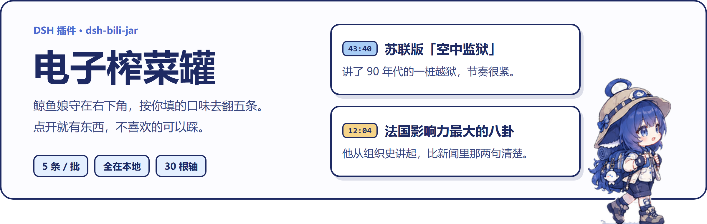
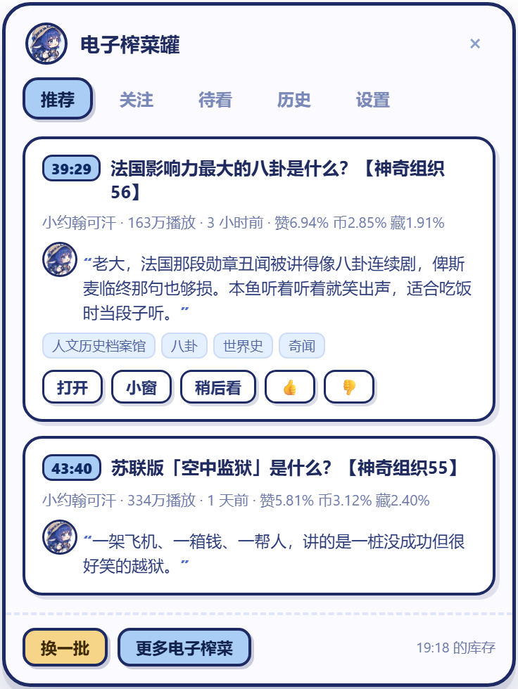

# 电子榨菜罐 · dsh-bili-jar

<p align="center">
  
</p>

她平时睡着。点一下罐子，她就出门找，回来把五条装进罐子，再和你说说这些视频讲了什么。

<p align="center">
  
</p>

<sub>面板图是用插件自己那套 CSS 渲染的，不是屏摄 —— 真机上长得一样，只是多了窗口背景。</sub>

先看四行：

- 需要 **dsh ≥ 0.1.7**；装完要重启一次（插件在 bundle 层组装）。
- 需要 **你自己的 DeepSeek API Key**。一轮「换一批」大约 `¥0.004–0.01`。
- **第一次装要等一轮**（二三十秒），之后每次点开都是秒开。
- 数据全在你自己电脑上，不上传。

## 它能干什么

你告诉她想吃什么口味的：时政、游戏攻略、音乐、随便什么。她照着去找。

挑的时候不看谁播放高，看的是点赞、投币、收藏占播放的比例。那种没什么人看但看的人都很当真的，
反而更容易被她捞出来。

找过的都攒着。今天没被选上的，改天换个词可能又冒出来。

最后五条是模型从二十多条候选里挑的，每条配一句话：这期讲了什么、怎么讲的、适合什么时候看。
理由是照内容写的，不报数据。

五条里最多两条来自你常看的人，剩下三条去外面新翻，免得翻来覆去就那几个人。

自带的够用：30 根兴趣轴、68 个子簇、三套语气、五张头像，装好不用配。想加自己的轴，
设置页点「看建议」，她会从你攒下的片子里挖候选。清单在 [`docs/presets.md`](docs/presets.md)。

## 怎么用

点一下罐子打开面板，五个页签：

| 页签 | 干什么 |
|---|---|
| 推荐 | 她给的五条。点「换一批」重新找；「更多电子榨菜」从攒下的池子里再捞几条（不重新搜） |
| 关注 | 你固定盯的几个 UP 的最新投稿 |
| 待看 | 先存着，回头再看 |
| 历史 | 最近点开过的十条 |
| 设置 | API Key、兴趣轴、时长、播放门槛、多样性、语气、头像 |

点标题或者「小窗」看视频，看过的会自动从列表里消失，小红点也跟着减。

不感兴趣的可以 👍 或者 👎，点多了她会记住你偏爱谁。

**打开就有东西。** 上一批存在磁盘上，面板一开先摆出来，新的在后台慢慢找。找好了只在顶上挂一条
「新的一批装好了」，你点了才换——不会把你正在读的那几行抽走。

<p align="center">
  
</p>

<sub>点「换一批」，她就出门找；回来把新的装进罐子。</sub>

## 装

桌面版的 `desktop` profile 不让 CLI 装插件，只能手改依赖：

```jsonc
// ~/.dsh/profiles/desktop/package.json
{
  "dependencies": { "dsh-bili-jar": "^0.3.0" },
  "dsh": { "profile": { "bundles": ["@deepseek-ai/dsh-base", "dsh-bili-jar"] } }
}
```

```bash
cd ~/.dsh/profiles/desktop && pnpm install
```

其他 profile：

```bash
dsh plugin --profile web add dsh-bili-jar
```

装完重启 dsh，再**硬刷新页面**（Ctrl+Shift+R）。客户端脚本会被浏览器缓存，光点刷新不够。

确认版本对不对：开一次面板，设置页底部有版本号。

### 更新

npm 上的最新版：<https://www.npmjs.com/package/dsh-bili-jar>

```bash
pnpm up dsh-bili-jar@latest
```

桌面版如果依赖写死在 profile 里，就把版本号改成新的再 `pnpm install`。改动多的话，细节在
[`docs/publish.md`](docs/publish.md)。

## 第一次用

1. 点罐子 → 设置 → 填 API Key（DeepSeek 官方）
2. 改兴趣轴。默认那四根是我的口味，换成你的
3. 回「推荐」，点换一批

第一次要等一轮，之后都是秒开。

B 站登录是可选的：登了才能取 AI 字幕，「关注」页也得靠它拉投稿。设置里点一下出二维码，
扫完就存在本地了。

## 多久换一次

不是每半小时就在后台重跑一遍。那样既慢又费钱。分三档：

| 距上次完整找 | 做什么 |
|---|---|
| 不到 3 小时 | 不动，就用手里这批 |
| 3 到 24 小时 | 先出去打听一眼：常看的那几个人有没有新片，每根轴的最新一页也扫一下 |
| 超过 24 小时 | 正经找一轮 |

打听的时候只在真瞅见值得的片子时才会升级成完整找一轮。所以**「半天没变」是正常的**。两小时内本来就不会凭空多出好片。

「换一批」随时可以强制重来，不用等。

## 它会记住你什么

只有三样，而且只存在你自己电脑上：

- 你点过赞的
- 你加过待看的
- 你点开看过的

同一条视频点三次也只算一次，半年前的老账不算。攒到三次，那个人就算「熟人」了，
他发新片子会先拿来给你试，不等点赞率、投币率攒成形。

踩一次扣两次。踩多了就拉黑，以后不再去他那儿翻。

想从零开始：删掉 `~/.dsh/bili-jar/ups.json`，下次自己重新长。

## 数据都在哪

`~/.dsh/bili-jar/`。里面有设置、片单、池子、赞踩、待看、历史、登录凭证、运行日志。

人话版的摘要叫 `STATE.md`，里面写着现在什么配置、这一批推了什么、今天花了多少钱。
可以直接打开看。

完整清单在 [`docs/technical.md`](docs/technical.md#数据结构)。

## 隐私

- 只监听本机。跨站请求一律拒。你开着插件逛别的网页时，那边偷不到你的配置，也触发不了付费调用
- 不收集任何遥测，不往作者的服务器发东西。出站只有两处：`bilibili.com` 和你配的模型 API
- API Key 明文存在你本地的 `config.json` 里，但所有接口只回 `sk-••••后四位`，日志里也没有
- 不读别的插件的凭证，除非你在设置里显式打开「复用刷B站的登录」（默认关）

更细的（含小窗播放的 iframe、cookie 权限）在 [`docs/technical.md`](docs/technical.md)。

## 已知的问题

- 时政区很多视频没 tag，只能靠标题里的实体词猜。「时政」这个词在 B 站被考公内容占着，
  想要真·国际时政，得往兴趣轴里填几个具体的实体词。
- 学得很粗：她只知道「你点过这个人三次」，不知道你具体喜欢哪一点。
- 熟人要攒到三次才转正，新装的头几天名单是空的，这是正常的。
- 「关注」页和熟人投稿都靠 B 站登录。凭证不会自己续，过期了那两处就空着。会给提示，但你得重新扫码。
- 「更多电子榨菜」是从池子里按互动率捞的，不像首推那样经过模型，越往后越边缘。
- 常青轴（游戏攻略、音乐这类）如果池子里只有一条，那条可能会老得离谱。

## 最近的更新

**0.3.0**

- 点开罐子不再空白。上一次那批先摆出来，新的在后台慢慢找，找好了在顶上挂一条，点了才换。
- 罐子开始记人。点赞、加待看、点开看过，加起来三次就记住了。他发新片子会先拿来试。
- 但熟人最多占两条，剩下三条还是去外面翻，免得翻来覆去就那几个人。
- 不再每半小时重跑一遍。两小时内基本不动，隔一阵先出去打听一眼，一天才正经找一回。
- 「关注」页以前经常是空的，修好了。

**0.2.9**

- 片单有了点随机性。原来每次点开都差不多，现在前几条稳住，后面按分数抽。设置里能调。
- 新视频刚发出来没什么数据，先给一点临时分，不至于一上来就垫底。

**0.2.8**

- 一直是那几部老片，原因是新视频缺互动数据、永远排不进去。现在先给它补上数据再排。
- 播放数过一阵重查一次，涨得快的先查。
- 每天至少留一条这两天发的。

更早的版本在 [`docs/changelog.md`](docs/changelog.md)。

## 想往里看

- [`docs/technical.md`](docs/technical.md)：一轮怎么跑、打分权重、时效判定、熟人算法、数据结构、代码结构、工具与测试
- [`docs/presets.md`](docs/presets.md)：自带的 30 根轴、68 个子簇、语气和头像
- [`docs/tag-tree.md`](docs/tag-tree.md)：tag 聚类和分区骨架
- [`docs/open-issues.md`](docs/open-issues.md)：踩过的坑和怎么修的

## 许可

代码 MIT。插画（`assets/jar-*.png` / `av-*.png` / `walk-*.png`）由作者用豆包生成，随仓库提供，只用于这个插件的界面。
「哦鲸鲸」那档头像取自 [dsh-whale-widget](https://github.com/MeteorNOX/DeepSeek-Balance-Whale-Widget)（MIT），
详见 [NOTICE](NOTICE)。
