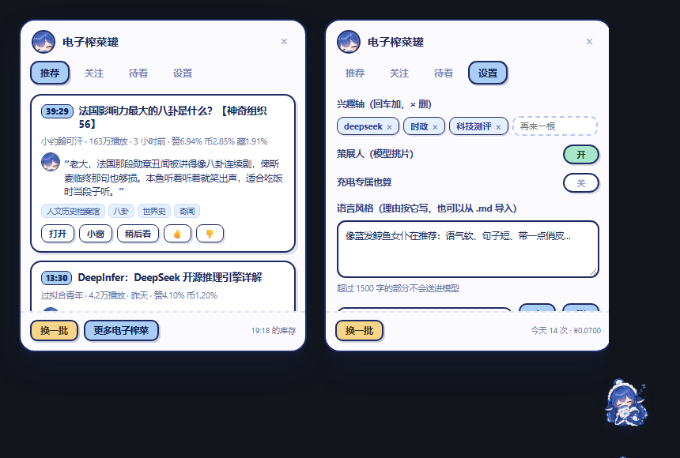
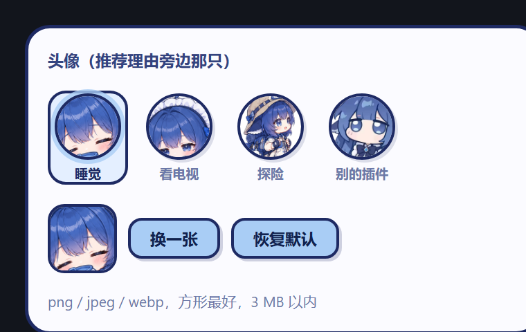

# 电子榨菜罐 · dsh-bili-jar

> 右下角一只罐子，替你挑「今天看哪几条」B 站视频。

**它不用 B 站 的推荐流。** 你写几根兴趣轴，它按轴去搜、按互动率而不是播放量排好坏，把结果攒进一个跨天的池子，最后交给大模型当策展人 —— 从二十多条候选里挑五条，并为每条写一句**讲内容、不讲数据**的推荐理由。

罐子平时是睡着的，装罐时会走两步：


## 界面



> 这张是用同一套 CSS 在本地渲染的预览，不是截屏；真实界面在 DSH 里，右下角。

## 它怎么挑片

一条视频要过六关，才有资格被模型看见：

```
① 搜     4 根轴 × 3 个词（其中 1 个按小时轮换）→ 9 次搜索 ≈ 180 条
② 并池   和上一轮的池子合并，同一个 BV 只更新数据（播放取大值）
③ 筛     时长 8–90 分、播放 ≥1 万、充电专属 ✗、直播回放 ✗、发布超 14 天 ✗、贴不上任何轴 ✗
④ 打分   赞/币/藏/弹幕的「率」+ 新鲜度 + 有字幕 + 覆盖几根轴
⑤ 补查   前 12 名回查真实投币数（搜索接口给的是旧的），重新打分
⑥ 策展   只把**前 24 名**交给模型，让它挑 5 条、写理由
```

几个刻意的设计：

- **不用播放量排序。** 播放量衡量的是「被推过多少」，赞、币、藏衡量的是「看过的人多喜欢」。
- **只给模型 24 条**，不是整个池子 —— 一次调用两三分钱，靠的就是这个。
- **宁可 3 条不凑数。** 提示词里写死了「宁缺毋滥」。
- **理由里不许出现数字。** 「赞 6.9%」这种话对决定看不看没有帮助，数据用来挑，不用来论证。

模型没开或调用失败时，退回纯规则挑：每根轴先挑一条相似度 ≥0.85 的，同轴最多 2 条、同 UP 最多 1 条。

## 现在能做什么

**挑片**

- 按轴定向搜索，词表可在面板里改
- 硬过滤：时长 / 播放门槛 / 充电专属 / 直播回放 / 太旧 / 贴不上轴
- 互动率打分，💎 标记「收藏率 + 投币率双双进前 20%」的宝藏
- 跨天累积池：今天没搜到的好东西，明天被别的词带出来也不会丢

**看**

- **小窗播放**：卡片上点「小窗」，右下角浮一个 B站 播放器（可拖动、Esc 关闭），不用跳走
- 稍后看：本地清单，落在磁盘上
- 👍 / 👎 记录在本地（**目前只存不用**，攒够 20 条才会参与打分）

**换**

- **换一批**：真排除上一批，不是重排
- **更多电子榨菜**：不重新搜，直接从池子里再捞 3 条；推荐语优先用存过盘的，查不到才叫模型

**调**

- 语气预设：把喜欢的语气存下来，一键切；也能**直接导入 `.md`**（人格文档、提示词随便丢）
- 头像预设四档：睡觉 / 看电视 / 探险 / 哦鲸鲸
- 全在面板里，不用碰 DSH 原生设置页



## 记账

每次调用都记 token 和钱，分三层看：**单次 / 今天 / 累计**。

计价按 DeepSeek 官方规则：**北京时间 周一至周五 09:00–12:00、14:00–18:00 为峰时**，其余（含周末与法定节假日）半价。

| | 缓存命中 | 未命中 | 输出 |
|---|---|---|---|
| 峰时（元/百万 token） | 0.04 | 2 | 8 |
| 谷时 | 0.02 | 1 | 4 |

一轮「换一批」（挑 5 条 + 写理由）大约 **¥0.004–0.01**，取决于时段和理由长度。

> 早先版本按本机时区判峰谷，在 UTC+11 的机器上会把傍晚的调用当成谷时，成本算成一半 —— 已修，历史账按各自的 `ts` 重算。

## 安装

⚠️ 桌面版 DSH 的 `desktop` profile 不允许用 CLI 装插件（`profile "desktop" is managed exclusively by the Electron application`），只能手工改依赖：

```jsonc
// ~/.dsh/profiles/desktop/package.json
{
  "dependencies": { "dsh-bili-jar": "link:D:/你的路径/电子榨菜罐" },
  "dsh": { "profile": { "bundles": ["@deepseek-ai/dsh-base", "dsh-bili-jar"] } }
}
```

```bash
cd ~/.dsh/profiles/desktop && pnpm install
```

装好后也可以从 npm 装（非桌面版）：

```bash
dsh plugin --profile web add dsh-bili-jar
```

装完**必须重启 DSH**（bundle 层要重新组装），再刷新页面（客户端 bundle 是页面加载时注入的）。

## 第一次用要做什么

1. 打开罐子 → **设置**
2. 填 **API Key**（DeepSeek 官方），或者留着空 —— 插件会试宿主模型
3. 改 **兴趣轴**：`deepseek` / `时政` / `科技测评` / `历史` 只是我的口味，换成你的
4. 回到「推荐」，点 **换一批**

B站 登录是可选的：不登也能挑片、能看；登录只是为了取 AI 字幕（判断内容用）。二维码由插件自己编码画出（`lib/qr.mjs`，零依赖），凭证只落在 `~/.dsh/bili-jar/credential.json` —— **不借用、也不读**别的插件的登录态（除非你在设置里显式勾选）。

## 数据都在哪

`~/.dsh/bili-jar/`

| 文件 | 内容 |
|---|---|
| `config.json` | 面板里改的所有设置 + 语气预设（**不含**上传的头像图） |
| `feed.json` / `pool.json` | 当前片单 / 累积池 |
| `reasons.json` | 攒下来的推荐理由（关掉再开还能用） |
| `usage.json` | 每次调用的 token 与费用 |
| `feedback.jsonl` / `later.json` | 赞踩 / 待看 |
| `credential.json` | B站 登录（只有你扫码才有） |
| `STATE.md` | 自动维护的人话摘要：现在是什么配置、这一批推了什么、花了多少 |

- API Key 存在 `config.json` 里（明文），**所有 HTTP 接口只返回 `sk-••••后四位`**
- `STATE.md` 每次启动和每轮刷新后重写，删了会自动再生成

## 已知的限制

- **时政区大量视频没有 tag**，只能靠标题里的实体词判定；「时政」这个词在 B 站 被考公内容占领，真·国际时政得用实体词搜（见 `docs/tag-tree.md`）
- **👍/👎 还没接进打分**：先在攒数据，等够 20 条再决定怎么用
- **小窗播放依赖 B站 的 embed 播放器**：大会员专享、UP 主关了外链的视频在里面可能放不出来，那就点「打开」
- **越往后捞越靠池子边缘**：「更多电子榨菜」按互动率排队，不像首推那样经过模型判断，贴轴程度会下降
- 粉丝数按 UP 单独查，只对进决赛圈的候选查

## 结构

| 文件 | 干什么 |
|---|---|
| `index.js` | host 半端：配置、HTTP 路由、累积池落盘、策展接线 |
| `client.js` | 浏览器半端：罐子 + 面板（`__ModuleLoader__` 自注册） |
| `lib/bili.mjs` | B站 客户端：WBI 签名 / 搜索 / 详情 / 粉丝 / 投稿 / 字幕 |
| `lib/pool.mjs` | 候选池：轴匹配、硬过滤、打分、按轴轮转 |
| `lib/curator.mjs` | 让模型当策展人：一次调用挑 N 条并写理由 |
| `lib/reasons.mjs` | 写理由（API 直连 → 宿主模型兜底），带磁盘缓存 |
| `lib/usage.mjs` | token 记账 + 峰谷计价 |
| `lib/qr.mjs` | 零依赖 QR 编码器（登录二维码用它画） |
| `lib/statefile.mjs` | 生成 `STATE.md` |
| `lib/hostdeps.mjs` | 从宿主树里取 `@deepseek-ai/*`（含桌面版 `app.asar` 路径） |
| `docs/publish.md` | 发 npm、上架插件市场的步骤 |

## 工具

```bash
node tools/why.mjs BV1xxxxx     # 这条为什么没进罐子？逐关诊断
node tools/feed.mjs 10000 0     # 跑一次建池，打印片单
node tools/probe.mjs deepseek   # 勘探接口字段
node tools/qr-check.mjs         # QR 编码器 vs Python qrcode 逐位比对
node tools/snapshot.mjs         # 备份数据 + 重写 STATE.md
python tools/cutout.py in.png out.png   # 抠掉画在图里的棋盘格
python tools/sprites.py                 # 从设定表切走路帧
```

## 许可与素材

代码 MIT。

- 插画（`assets/jar-*.png`、`av-*.png`、`walk-*.png`）由作者用豆包生成，随仓库提供，仅用于本插件界面
- 「哦鲸鲸」那档头像取自 [dsh-whale-widget](https://github.com/MeteorNOX/DeepSeek-Balance-Whale-Widget)（MIT），详见 [NOTICE](NOTICE)
